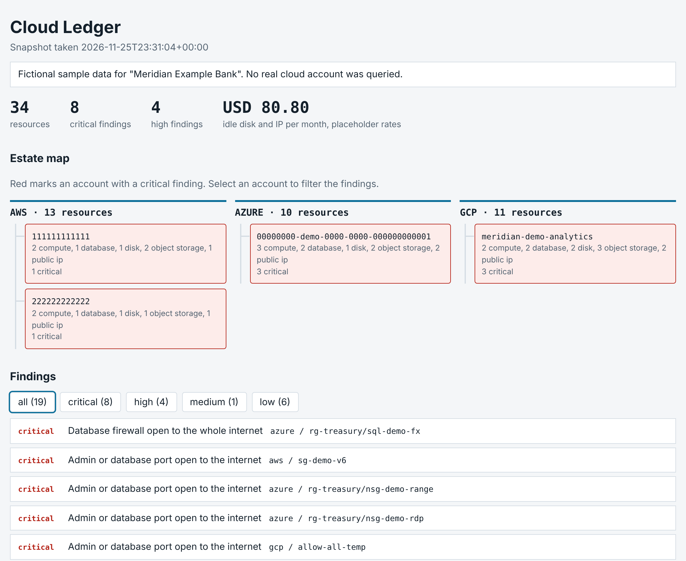
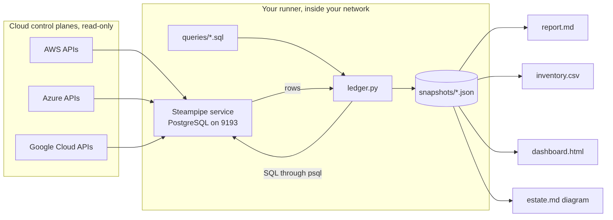

# cloud-ledger

**One inventory for AWS, Azure and Google Cloud, queried with SQL through [Steampipe](https://github.com/turbot/steampipe).** It answers four questions leaders keep asking:

1. What do we run, and where?
2. What is open to the internet?
3. What are we paying for and not using?
4. What changed since last time, and who owns it?



## How it works



More diagrams (run sequence, access model, data model, drift and exposure logic) are in [docs/architecture.md](docs/architecture.md). Each report also draws **your estate** as a diagram in `out/estate.md`.

## Try it in three commands

```bash
make db-up
make demo
open out/dashboard.html     # Linux: xdg-open
```

The demo uses fictional data for "Meridian Example Bank".

## Hands-on labs

| Lab | You will | Needs |
|---|---|---|
| [1. Offline](labs/01-offline.md) | Run the pipeline, query by hand, break a rule and catch it | PostgreSQL |
| [2. Connect](labs/02-connect.md) | Set up read-only access to real clouds | Steampipe, one non-production account |
| [3. Live fire](labs/03-live-fire.md) | Create a real risk, detect it, remove it | A sandbox you may change |
| [4. Write a control](labs/04-write-a-control.md) | Add and test your own check | Lab 1 |
| [5. Operate](labs/05-operate.md) | Schedule it and protect its output | Lab 2 |

## Coverage

Inventory: virtual machines, disks, object storage, managed databases (Azure: SQL servers) and public IPs (Google Cloud: external static addresses).

| Control | Severity | AWS | Azure | GCP |
|---|---|:-:|:-:|:-:|
| NET-01 Ports 22, 1433, 3306, 3389, 5432 open to the internet | critical | yes | yes | yes |
| STO-01 Storage grants public access | critical | yes | | yes |
| DB-02 Database firewall open to any address | critical | | yes | yes |
| DB-01 Database has a public network path | high | yes | yes | yes |
| ENC-01 Unencrypted disk | high | yes | | |
| STO-02 Anonymous blob access permitted | medium | | yes | |
| COST-01 Unattached disk | low | yes | yes | yes |
| COST-02 Idle public IP | low | yes | yes | yes |
| COST-03 Stopped VM still billed | low | | yes | |

A blank cell means **not checked**.

## What has and has not been tested

| Item | Status |
|---|---|
| All six SQL packs on PostgreSQL 16 | Tested with fictional data, including look-alike safe cases |
| Table names, column names and types | Generated from the official plugin source; commits are in `tests/schema.json` |
| Reports, drift, incomplete-run handling, output escaping | Covered by tests |
| **A run against live Steampipe and real cloud accounts** | **Not yet done.** Complete Lab 2, including reconciliation. |
| Nested JSON in sample data | Modelled on plugin docs and cloud API formats, not recorded from real accounts |
| IAM template, cloud CLI commands, Docker targets, GitHub Actions workflow | Not yet executed |

## Limits to know before you rely on it

- No findings does not mean secure. This is a focused check set.
- Network checks do not work out effective reachability. Deny rules, priorities, hierarchical policies, routes and network ACLs are not evaluated. They also look only for the whole internet, not other broad ranges.
- AWS storage checks do not read ACLs or account-level Block Public Access.
- A finding that disappears may mean a narrower scope, not a fix.
- Dollar figures use placeholder rates in `config/rates.json` and cover idle disks and IPs only.
- Kubernetes, serverless, IAM identities and many other services are not covered.

## Layout

```text
ledger.py            collect, report, load-demo (standard library and psql only)
queries/             inventory and findings SQL per cloud, control catalogue
config/              Steampipe connections, AWS read-only role, price rates
dashboard/           single-file dashboard template
sample-data/         two fictional days
tests/               tests and plugin-derived table schemas
labs/ docs/          walkthroughs and diagrams
```

MIT licence for this repository. Steampipe and its plugins have their own licences.
