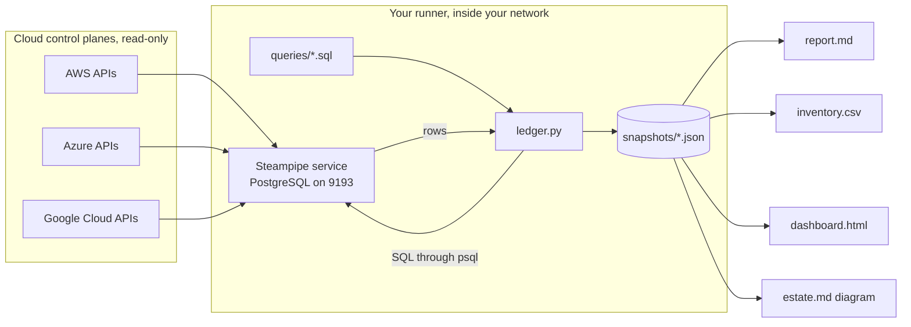
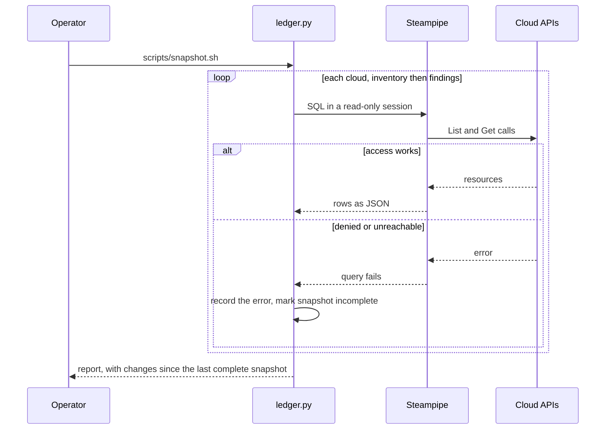
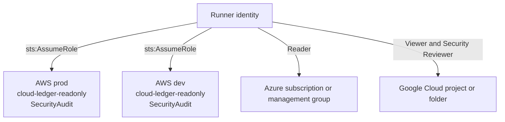
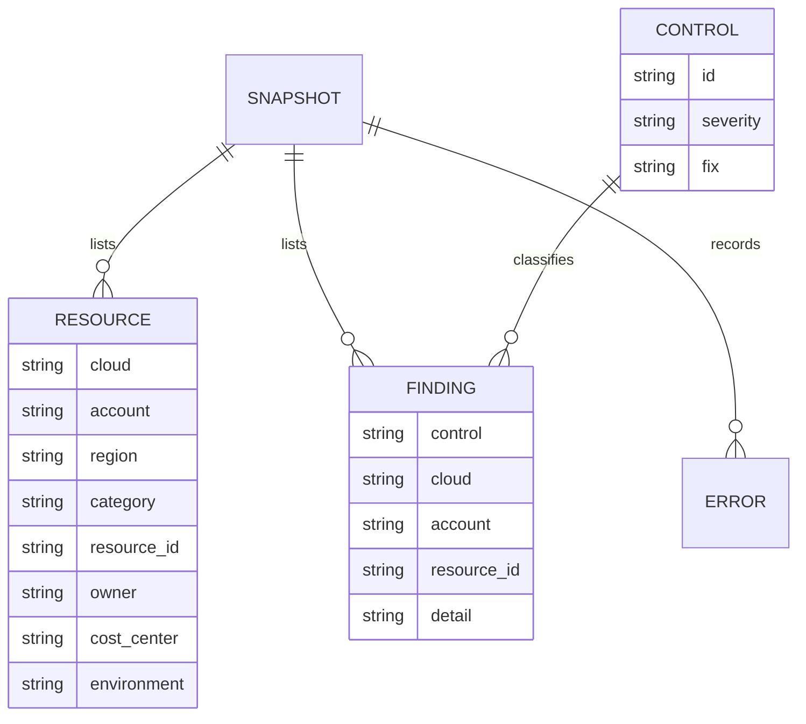
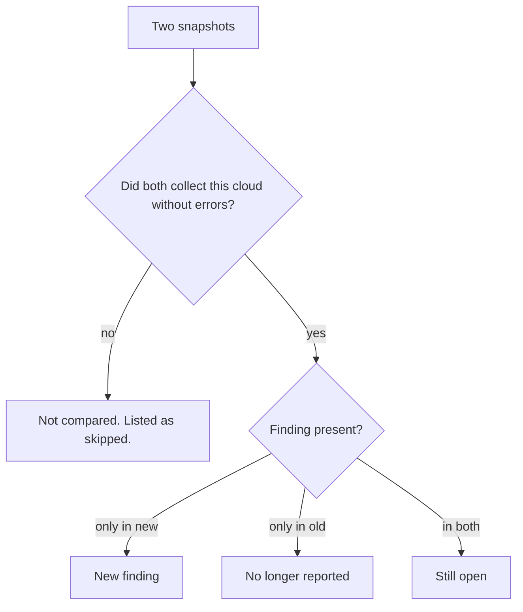
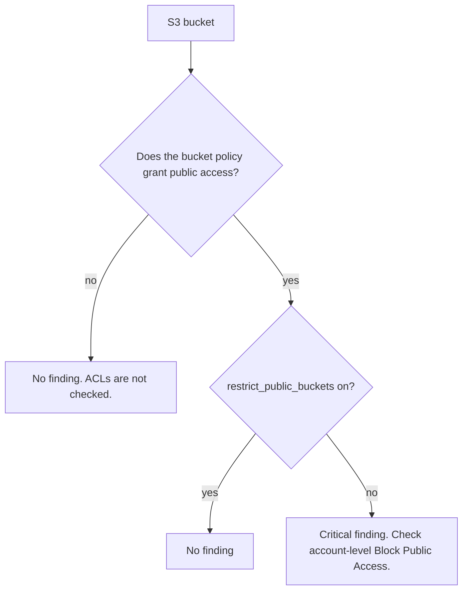

# Architecture diagrams

GitHub draws these automatically.

## 1. System

## 2. One collection run

## 3. Read-only access across many accounts

## 4. Shared inventory model

## 5. How drift is decided

"No longer reported" is not proof of a fix. A narrower region list or a removed account has the same effect.

## 6. When AWS storage counts as public (STO-01)

